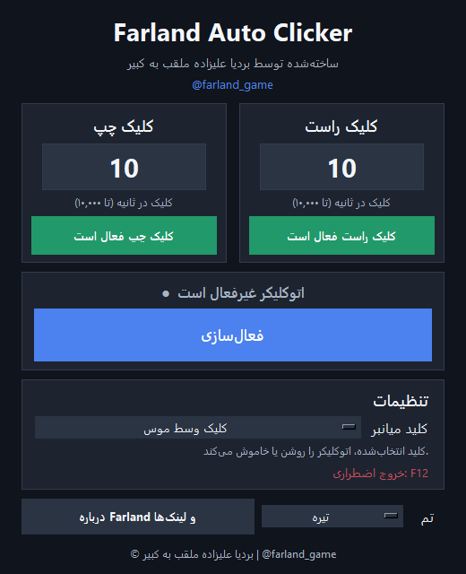

# Farland Auto Clicker

[English](../README.md) | [日本語](README.ja.md) | [فارسی](README.fa.md)

اتوکلیکر ویندوز با رابط فارسی، تنظیم جداگانهٔ سرعت کلیک چپ و راست، میانبر قابل تغییر و توقف اضطراری.

**ساختهٔ بردیا علیزاده، ملقب به کبیر، با نام هنری Farland_game**

**[دانلود فایل ZIP ویندوز](https://github.com/FarlandGame/Farland-Auto-Clicker/releases/latest/download/Farland-Auto-Clicker.zip)** · [همهٔ نسخه‌ها](https://github.com/FarlandGame/Farland-Auto-Clicker/releases)



## شروع استفاده

1. فایل `Farland-Auto-Clicker.zip` را دانلود و از حالت فشرده خارج کنید.
2. فایل `Farland-Auto-Clicker/dist/Farland Auto Clicker.exe` را باز کنید. نسخهٔ اجرایی به نصب جداگانهٔ Python نیاز ندارد.
3. تعداد کلیک در ثانیه (CPS) را برای چپ و راست تعیین کنید و سمت‌های موردنیاز را فعال کنید.
4. با کلیک وسط موس یا دکمهٔ اصلی برنامه، اتوکلیکر را روشن کنید.
5. هر کلیک واقعی چپ یا راست، یک نوبت کلیک اضافه با همان دکمه در طول یک ثانیهٔ بعد ایجاد می‌کند.
6. با **F12** تمام کلیک‌های در انتظار متوقف می‌شوند و برنامه بسته می‌شود.

## امکانات

- تنظیم مستقل سرعت چپ و راست، از **۱ تا ۱۰٬۰۰۰ CPS**.
- فعال یا غیرفعال کردن جداگانهٔ هر سمت.
- میانبر قابل انتخاب: کلیک وسط، دکمه‌های کناری موس، F6 تا F9، Home، End یا Insert.
- چهار تم تیره، روشن، بنفش و آبی.
- ذخیرهٔ تنظیمات برای اجرای بعدی.
- زمان‌بندی نوبت‌های هم‌زمان و ارسال دسته‌ای کلیک‌ها در سرعت بالا.
- جلوگیری از ایجاد چرخهٔ تکراری با تشخیص کلیک‌های مصنوعی ویندوز.

کلیک واقعی نیز به‌صورت عادی ثبت می‌شود. هر نوبت، به تعداد CPS تنظیم‌شده کلیک **اضافی** را در یک ثانیه برنامه‌ریزی می‌کند. چند کلیک واقعی می‌توانند نوبت‌های هم‌زمان ایجاد کنند. ۱۰٬۰۰۰ سقف قابل تنظیم است؛ سرعت واقعی به توان سیستم، پردازش ورودی ویندوز و محدودیت برنامهٔ مقصد بستگی دارد.

## کنترل‌ها و تنظیمات

| کنترل | عملکرد |
| --- | --- |
| دکمهٔ اصلی / میانبر انتخاب‌شده | روشن یا خاموش کردن اتوکلیکر |
| F12 | توقف اضطراری و خروج |
| Enter / خروج از فیلد CPS | اعمال مقدار معتبر |

ورودی نامعتبر به مقدار قبلی بازمی‌گردد. تنظیمات در `%APPDATA%\Farland Auto Clicker\settings.json` ذخیره می‌شوند.

## اجرا از کد

به **ویندوز ۱۰ یا ۱۱** و **Python 3.10 یا جدیدتر** همراه با Tkinter نیاز دارید. برای اجرای کد، کتابخانهٔ شخص ثالث لازم نیست.

```powershell
py main.py
```

## ساخت نسخهٔ اجرایی

در پوشهٔ پروژه اجرا کنید:

```powershell
py -m pip install -r requirements.txt
py create_icon.py
py -m PyInstaller --noconfirm --clean "Farland Auto Clicker.spec"
```

خروجی در `dist/Farland Auto Clicker.exe` قرار می‌گیرد. برای کار با برنامه‌ای که با دسترسی مدیر اجرا شده، اتوکلیکر را هم با همان سطح دسترسی اجرا کنید؛ ویندوز ورودی به برنامه‌های دارای سطح دسترسی بالاتر را محدود می‌کند.

## ساختار پروژه

| فایل | کاربرد |
| --- | --- |
| `main.py` | رابط Tkinter، کنترل‌ها، تم‌ها و لینک‌های سازنده |
| `click_engine.py` | هوک‌های ورودی ویندوز و زمان‌بندی کلیک |
| `settings.py` | اعتبارسنجی تنظیمات و ذخیرهٔ اتمی JSON |
| `create_icon.py`, `farland.ico` | آیکون برنامه |
| `Farland Auto Clicker.spec` | تنظیمات ساخت با PyInstaller |
| `test_click_engine.py` | آزمون زمان‌بندی و رفتار هوک‌ها |
| `docs/` | راهنمای فارسی و ژاپنی |

فایل ZIP منتشرشده شامل نسخهٔ اجرایی موجود و کد منبع است. کش ساخت و فایل‌های موقت از بسته حذف شده‌اند.

## آزمون‌ها

روی ویندوز:

```powershell
py -B -m unittest -v test_click_engine
```

این آزمون‌ها از فرستندهٔ شبیه‌سازی‌شده استفاده می‌کنند و کلیک واقعی موس ایجاد نمی‌کنند.

## سازنده

**بردیا علیزاده، ملقب به کبیر · Farland_game**

[صفحهٔ نمونه‌کارهای گیت‌هاب](https://github.com/FarlandGame)

### کانال‌ها و شبکه‌های اجتماعی

| پلتفرم | کانال‌ها / صفحه‌ها |
| --- | --- |
| YouTube | [Farland_game](https://www.youtube.com/@Farland_game) · [Farland_animation](https://www.youtube.com/@Farland_animation) |
| کانال‌های روبیکا | [farland_gam](https://rubika.ir/farland_gam) · [Farland_animatio](https://rubika.ir/Farland_animatio) |
| صفحه‌های روبیکا | [farland_game](https://rubika.ir/farland_game) · [Farland_animations](https://rubika.ir/Farland_animations) |
| Instagram | [farland_game](https://www.instagram.com/farland_game/) |
| کانال‌های تلگرام | [Farland_gam](https://t.me/Farland_gam) · [Farland_animatio](https://t.me/Farland_animatio) |
| Twitch | [farlandgame](https://twitch.tv/farlandgame) |
| Kick | [farlandgame](https://kick.com/farlandgame) |
| Aparat | [Farland_Game](https://aparat.com/Farland_Game) |
| SoundCloud | [Bardiya Kabir](https://soundcloud.com/bardiya-kabir-798008614) |

### ربات موسیقی تلگرام

[ربات Farland Music Bot](https://t.me/Farland_Music_bot) — لینک ویدیوی آهنگ موردعلاقه‌ات را به ربات تلگرامی ما بفرست تا آهنگ را پیدا کنی.

### جامعه و خانواده

- **THE APEX:** [یوتیوب](https://www.youtube.com/@THE_APEX_MC) · [تلگرام](https://t.me/+-3uY7eIZArVjZDE0)
- **منهانت:** [گروه تلگرام](https://t.me/+DAq20XrkPyZhNjVk)
- **کانال برادرم:** [ArmiyaFabix در یوتیوب](https://www.youtube.com/@ArmiyaFabix)

### حمایت از کارهای من

[حمایت مالی از طریق ریمیت](https://reymit.ir/farland_game) ❤️
